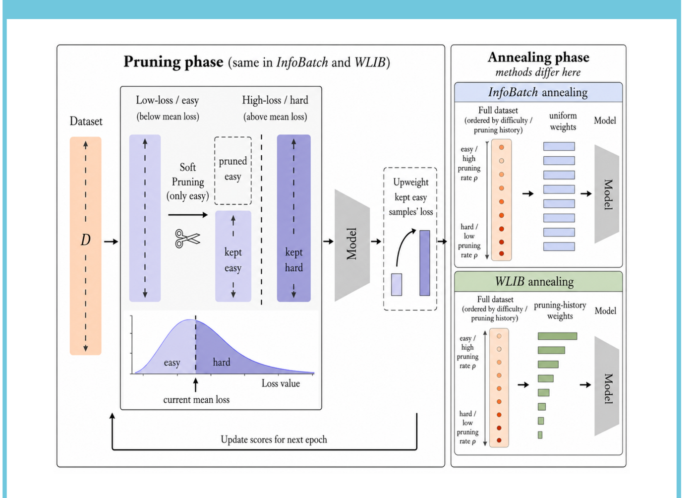
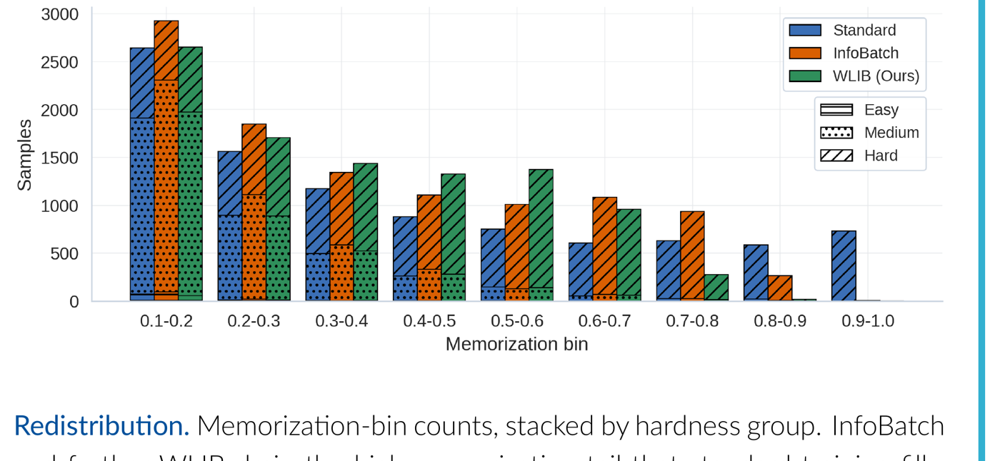

# Prune to Protect: Faster Training and Enhanced Privacy by Dynamic Data Pruning

<p align="center">
  <a href="https://neurips.cc/virtual/2026/poster/151415"><b>📄 NeurIPS 2026</b></a>
</p>

---

## TL;DR

Deep networks fit the easy examples first and **memorize the hard, atypical tail late in training** — and
that memorized tail is exactly what leaks under **membership-inference attacks (MIA)**. We ask what happens
to that memorization when training no longer sees every example equally: under **dynamic data pruning**, easy
samples are skipped and hard ones are kept, so the hard tail is actually *exposed more often*.

The surprising answer: dynamic pruning **prioritises hard samples yet memorizes them less**, and this
translates directly into **lower privacy leakage**. We push the effect further with **WLIB** (Weighted Loss
InfoBatch), which reweights examples by how often they were pruned. Across CIFAR‑10, CIFAR‑100 and ImageNet
(both ResNet‑50 and DeiT‑Small), **WLIB has the lowest membership-inference AUC and TPR@1%**, while
**accuracy stays close** and InfoBatch's compute saving is retained: WLIB trains on ~65% of the data
(**−35% training FLOPs** on CIFAR‑10, ≈−32% on CIFAR‑100) and adds no extra passes.

> **Privacy essentially for free:** you keep the accuracy, you keep the speedup, and you leak less.

---

## The question

- Standard SGD fits easy samples first, then **memorizes the hard, atypical tail late in training** (Arpit et al., 2017).
- Per‑sample memorization strongly predicts **vulnerability to membership‑inference** — the memorized tail carries the most privacy risk (Choi et al., 2023).
- Yet memorization is **necessary for generalization** (Feldman, 2020) — you cannot simply throw the tail away.

**Dynamic data pruning** skips easy samples each epoch and keeps the hard ones, so hard samples are *exposed
more often* — effectively changing the training curriculum. **Does this altered exposure reshape memorization,
and does it propagate to membership‑inference vulnerability?**

## Pruning rate as a proxy for hardness

We define each sample's **cumulative pruning rate**, where $`T_s`$ is the epoch at which annealing begins:

```math
\rho_i = \frac{\text{number of epochs in which } i \text{ is pruned}}{T_s}
```

Easy samples are pruned often (**high ρ**); persistently hard samples are almost never pruned (**low ρ**). This
single quantity — obtained for free from the pruning schedule — is what we use to split the data into
**easy / medium / hard** groups and, in WLIB, to reweight the loss.

## Method: InfoBatch and WLIB

<p align="center"></p>

- **InfoBatch** (Qin et al., 2023) — each epoch, soft‑prunes low‑loss (easy) samples and upweights the kept
  easy ones; then **anneals** on the full dataset for the last epochs. Faster training at no accuracy cost.
- **WLIB (ours)** — inherits InfoBatch's pruning phase, then at the **start of annealing freezes each sample's
  cumulative pruning rate ρ** and uses it as a **multiplicative weight on the loss**. Persistently‑hard samples
  (low ρ) are down‑weighted precisely during the phase where late memorization would otherwise happen.

## What we find

<p align="center"></p>

- **Redistribution.** InfoBatch, and WLIB further, **drain the high‑memorization tail** that standard training
  fills, shifting mass to the middle bins.
- **Suppressed memorization despite more exposure.** Mean hard‑group memorization over training stays **below**
  standard training — WLIB lowest at the end — even though pruning shows these samples *more* often.
- **Annealing surge, controlled.** The memorization that standard/InfoBatch gain during annealing concentrates
  on the lowest‑ρ (hardest) samples; WLIB's reweighting **suppresses it throughout**.

## Results: privacy at matched accuracy

**Defense‑unaware RMIA** (Zarifzadeh et al., 2024) under the standard auditing protocol: target and shadow
models are trained on random 50% subsets, and test accuracy comes from a separately trained full‑data model.
CIFAR‑10 and CIFAR‑100 use online RMIA (64 shadows, 20 targets); ImageNet uses offline RMIA (2 shadows, a=1.0,
4 targets). Numbers are from the paper (Table 1 and Table 7). **Lower is better** for AUC/TPR, **higher** for
accuracy; best per dataset in **bold**.

| Dataset (Model) | Method | AUC ↓ | TPR@0% ↓ | TPR@0.01% ↓ | TPR@1% ↓ | Test Acc ↑ |
|---|---|:--:|:--:|:--:|:--:|:--:|
| **CIFAR‑10** (ResNet‑20) | Standard | 71.82 | 1.87 | 3.15 | 13.76 | **92.21** |
| | InfoBatch | 66.69 | 0.74 | 1.25 | 8.47 | 91.74 |
| | **WLIB** | **61.43** | **0.20** | **0.40** | **4.58** | 91.64 |
| **CIFAR‑100** (WRN‑28‑2) | Standard | 91.02 | 4.89 | 7.80 | 34.74 | 74.27 |
| | InfoBatch | 88.56 | 1.81 | 3.57 | 25.20 | 73.63 |
| | **WLIB** | **88.06** | **1.22** | **2.39** | **21.59** | **74.34** |
| **ImageNet** (ResNet‑50) | Standard | 73.7 | 0.0 | 1.50 | 17.4 | **76.53** |
| | InfoBatch | 73.3 | 0.0 | 1.13 | 15.5 | 75.95 |
| | **WLIB** | **72.9** | 0.0 | **0.60** | **12.9** | 75.85 |
| **ImageNet** (DeiT‑Small) | Standard | 78.34 | 0.0 | 0.0 | 19.4 | **72.9** |
| | InfoBatch | 79.30 | 0.0 | 0.0 | 19.5 | 72.2 |
| | **WLIB** | **77.12** | 0.0 | 0.0 | **17.3** | 72.5 |
| **CelebA** (ResNet‑10t) | Standard | 53.3 | 0.0 | 0.02 | 2.9 | 95.63 |
| | InfoBatch | 54.5 | 0.0 | 0.02 | 3.5 | 95.56 |
| | **WLIB** | **52.9** | 0.0 | **0.00** | **2.2** | **95.71** |

WLIB attains the **lowest AUC and lowest TPR@1%** in all five settings, with accuracy within ~0.7 points of
standard (and *above* it on CIFAR‑100 and CelebA). The gain is **architecture‑agnostic**: it holds for the
DeiT‑Small transformer, where InfoBatch alone barely moves the needle. On CIFAR‑10, TPR@1% falls **3×** from
Standard to WLIB.

## Takeaways

- Dynamic data pruning **prioritises hard samples, yet memorizes them less** — and WLIB improves this further.
- WLIB's annealing **reweights samples by their pruning‑phase exposure**, improving on InfoBatch's annealing.
- **Reduced memorization translates into lower membership‑inference risk** — a better privacy–utility–efficiency
  trade‑off, at no extra training cost, across CNNs and transformers.

---

## Reproducing the results

Dataset, model and method are all command-line arguments. The paper's three methods are `standard`,
`infobatch` and `wlib`.

```bash
bash env/setup_cifar.sh && source env/venv/bin/activate
export MPLBACKEND=Agg
```

**Accuracy (5 seeds):**

```bash
python scripts/train.py --dataset cifar10  --model resnet20 --method wlib --seeds 0 1 42 1234 3407
python scripts/train.py --dataset cifar100 --model wrn28_2  --method wlib --seeds 0 1 42 1234 3407
```

**Membership inference.** Trains the shadow and target banks if missing (64 shadows, 20 targets) and runs
the attack. `compute_privacy.py` then reports per-target AUC and TPR at each FPR:

```bash
python scripts/attack.py --dataset cifar10  --model resnet20 --target-method standard --attack rmia --online --num-targets 20
python scripts/attack.py --dataset cifar10  --model resnet20 --target-method wlib     --attack rmia --online --num-targets 20
python studies/compute_privacy.py
```

**Memorization.** Trains the 400-model subset bank and computes leave-one-out memorization scores:

```bash
python studies/cifar10_loo.py --methods standard infobatch wlib
```

[`docs/REPRODUCE.md`](docs/REPRODUCE.md) maps every table and figure in the paper to a command and lists the
expected numbers. ImageNet needs a separate FFCV environment: see
[`src/prunepriv/imagenet/README.md`](src/prunepriv/imagenet/README.md).
[`docs/ARCHITECTURE.md`](docs/ARCHITECTURE.md) explains how the code fits together and the
`docs/ADD_A_*.md` files show how to extend it.

---

## License

MIT, see [`LICENSE`](LICENSE). Third-party code is listed in
[`THIRD_PARTY_NOTICES.md`](THIRD_PARTY_NOTICES.md).
